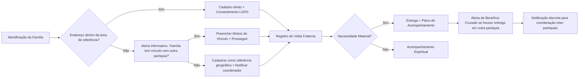

# Vicentino Connect

# 📄 DOCUMENTO MESTRE DO PROJETO  
## Sistema de Gestão Pastoral Vicentina – Controle Territorial  
### **PRD v4.0 – Documento Fundacional Refatorado**  

| Metadado | Informação |
|----------|-----------|
| **Nome do Produto** | Controle Vicentino Umuarama |
| **Paróquia Piloto** | São Paulo Apóstolo – Diocese de Umuarama/PR |
| **Tecnologia Base** | Google AppSheet + Google Sheets + Apps Script |
| **Versão** | 4.0 (Fundacional Refatorada) |
| **Data** | 02 de junho de 2026 |
| **Status** | ✅ Aprovado para Implementação Imediata |
| **Classificação** | Dados Sensíveis – Uso Restrito (LGPD) |

---

## 🎯 1. SUMÁRIO EXECUTIVO

### 1.1 Problema Central
Os Grupos Vicentinos operam com registros em papel, gerando:
- Duplicidades não intencionais de atendimentos entre paróquias
- Perda de histórico e rastreamento de famílias
- Dificuldade de coordenação pastoral e prestação de contas
- Risco de vazamento ou acesso indevido a dados sensíveis

### 1.2 Solução Proposta
Plataforma colaborativa, mobile-first e offline-capable para:
- Cadastro único com validação territorial **informativa** (não bloqueante)
- Registro de visitas e entregas com dimensão espiritual e material
- Alertas inteligentes de coordenação inter-paróquias baseados em **vínculo pastoral**
- Conformidade LGPD nativa (consentimento, anonimização, auditoria)
- Interface acessível para voluntários de todas as idades

### 1.3 Princípios Norteadores
```
🕊️ Território é referência, não fronteira. Vínculo pastoral prevalece.
🤝 Tecnologia serve ao acolhimento, nunca o substitui ou burocratiza.
🔒 Privacidade por design: acesso mínimo, dados sensíveis protegidos.
📊 Transparência com responsabilidade: relatórios agregados, nunca exposição.
♿ Acessibilidade real: interface limpa, offline-first, microcopy acolhedor.
```

---

## ⛪ 2. ESCOPO PASTORAL E TEOLÓGICO

### 2.1 Filosofia Territorial Refatorada
| Conceito | Implementação no Sistema |
|----------|--------------------------|
| **Geografia como referência** | Sistema identifica automaticamente a paróquia de referência pelo bairro, mas **não bloqueia** cadastros externos |
| **Vínculo pastoral como critério** | Campo obrigatório `Motivo_Vínculo` quando a família escolhe outra paróquia. Registro é acolhedor, não investigativo |
| **Duplicidade como oportunidade de coordenação** | Alerta informativo sugere diálogo inter-paróquias. Nunca impede atendimento ou entrega |
| **Acompanhamento integral** | Histórico une visitas, necessidades materiais, intenções de oração e plano de superação |

### 2.2 Fluxo Pastoral Ajustado


### 2.3 Indicadores Pastorais (KPIs)
| Indicador | Cálculo | Meta Piloto |
|-----------|---------|-------------|
| Taxa de Retorno | `(Famílias ≥2 visitas/90d) / Total Ativo` | ≥ 60% |
| Vínculo Declarado | `% de famílias com Paróquia_Vínculo ≠ Referência` | Registrar e analisar |
| Coordenação Inter-Paróquias | `(Casos alinhados) / (Alertas cruzados)` | ≥ 80% |
| Intenções de Oração Registradas | `COUNT(Visitas[Opcional_Intencao]) / Total` | ≥ 40% |
| Satisfação do Voluntário (NPS) | Pesquisa trimestral | ≥ 8/10 |

---

## ⚖️ 3. ESCOPO JURÍDICO E LGPD

### 3.1 Classificação e Minimização de Dados
| Categoria | Exemplos | Regra de Acesso |
|-----------|----------|----------------|
| **Identificação** | Nome, CPF, telefone, endereço | Visível a todos os perfis vinculados |
| **Sensíveis** | Saúde, vulnerabilidade, observações | `Show_If`: Admin/Coordenador apenas |
| **Auditoria** | Logs de acesso, alterações, consentimentos | Imutável, retenção 5 anos |
| **Agregados** | Estatísticas por bairro, faixa etária | Exportação pública anonimizada |

### 3.2 Direitos do Titular e Fluxos Técnicos
| Direito | Implementação |
|---------|--------------|
| **Acesso** | Botão "Exportar Meus Dados" gera PDF com registros do CPF |
| **Correção** | Solicitação via formulário → Notifica coordenador → Alteração com log |
| **Anonimização** | Ação "Encerrar com Anonimização": limpa Nome/CPF/Telefone, mantém ID e estatísticas |
| **Revogação** | `Consentimento_LGPD = FALSE` → bloqueia novos registros, arquiva histórico |

### 3.3 Governança Legal
- **Controlador**: Paróquia São Paulo Apóstolo (CNPJ: ____)
- **DPO**: Nomeado e contato público divulgado no site/paroquial
- **Base Legal**: Legítimo interesse (Art. 7º, IX) + Consentimento (Art. 7º, I)
- **Retenção**: Dados ativos + 2 anos após encerramento. Após isso: anonimização ou exclusão segura.

---

## 💻 4. ESCOPO TÉCNICO E DE DESENVOLVIMENTO

### 4.1 Arquitetura
```
┌─────────────────────────────────────┐
│  FRONTEND: Google AppSheet (Mobile) │
│  - PWA, Offline-first, Push Alerts  │
└────────────┬────────────────────────┘
             │ HTTPS / REST
┌────────────▼────────────────────────┐
│  BACKEND: Google Sheets + Apps Script│
│  - Planilha: Controle_Vicentino_Umuarama │
│  - Scripts: Backup, Anonimização, Notifs │
└────────────┬────────────────────────┘
             │ Google Drive
┌────────────▼────────────────────────┐
│  ARMAZENAMENTO:                     │
│  - Dados estruturados: Sheets       │
│  - Anexos (termos, fotos): Drive    │
│  - Logs: Sheets + Audit Trail       │
└─────────────────────────────────────┘
```

### 4.2 Estrutura de Dados (Google Sheets)

#### 🔹 Tabela: `Assistidos` (Core Atualizada)
| Campo | Tipo | Validação/Regra | Observação |
|-------|------|-----------------|------------|
| `ID` | Text | `UNIQUEID()` (AppSheet) | Chave imutável |
| `CPF` | Text | Regex `\d{3}\.\d{3}\.\d{3}-\d{2}`, Único | Máscara visual no front |
| `Nome_Completo` | Text | Required | |
| `Data_Nascimento` | Date | ≤ TODAY() | Cálculo idade automático |
| `Rua, Numero, Bairro, Complemento` | Text | | |
| `Paroquia_Referencia_Geografica` | Ref | `Paroquias_Grupos` (lookup por bairro) | Automático, somente leitura |
| `Paroquia_Vinculo_Escolhida` | Ref | `Paroquias_Grupos` | Editável, default = referência |
| `Motivo_Vinculo` | Enum+Text | `["Frequenta missa aqui","Família histórica","Indicação vicentina","Proximidade com grupo","Outro: ___"]` | [Show_If]: `Vínculo ≠ Referência` |
| `Territorio_Validado` | Enum | `["Sim","Não","Em análise"]` | Informativo |
| `Status_Assistido` | Enum | `["Ativo","Em acompanhamento","Suspenso","Encerrado","Em análise territorial"]` | |
| `Data_Ultima_Visita` | Date | Auto-update (Automation) | |
| `Data_Ultima_Entrega` | Date | Auto-update (Automation) | |
| `Consentimento_LGPD` | Boolean | Required + Anexo | |
| `Flag_Duplicidade_Beneficio` | Boolean | Calculado: entregas >1 paróquia/30d | Automático |
| `Observacoes_Sensiveis` | LongText | [Show_If]: `USERROLE() != "Voluntario"` | Dados sensíveis protegidos |

#### 🔹 Tabelas Relacionadas
| Tabela | Finalidade | Chave Estrangeira |
|--------|-----------|------------------|
| `Familiares` | Membros da família | `ID_Assistido` |
| `Visitas` | Registro de visitas | `ID_Assistido` |
| `Entregas` | Registro de benefícios | `ID_Assistido` |
| `Paroquias_Grupos` | Domínio territorial e responsáveis | `Paroquia, Grupo` |
| `Usuarios` | Controle de acesso | `Email_Google` |
| `Auditoria` | Log imutável | Preenchida por Automation |

### 4.3 Configuração AppSheet – Expressões Críticas
```appsheet
// 📍 Status Territorial (informativo)
IF(
  [Paroquia_Vinculo_Escolhida] = [Paroquia_Referencia_Geografica],
  "📍 Área de referência",
  "🔗 Vínculo pastoral: " & [Paroquia_Vinculo_Escolhida]
)

// 🤝 Alerta Inteligente de Duplicidade (não bloqueante)
IF(
  AND(
    COUNT(FILTER(Entregas, [ID_Assistido]=[_THISROW].[ID] AND [Data_Entrega]>=TODAY()-30))>0,
    COUNT(SELECT(Assistidos[ID], 
      AND([CPF]=[@CPF], [ID]!=[_THISROW].[ID], [Status_Assistido]!="Encerrado", 
          [Paroquia_Vinculo_Escolhida]!=[_THISROW].[Paroquia_Vinculo_Escolhida])
    ))>0
  ),
  "🤝 Família também vinculada à " & 
  LOOKUP([CPF],"Assistidos","CPF","Paroquia_Vinculo_Escolhida",[_THISROW].[Paroquia_Vinculo_Escolhida]) &
  ". Sugerir alinhamento de benefícios.",
  ""
)

// 🔐 Security Filter: Acesso por Grupo + Coordenação Inter-Paróquias
IF(
  USERROLE()="Voluntario",
  [Paroquia_Vinculo_Escolhida] = USERATTRIBUTE("Paroquia"),
  TRUE // Coordenadores/Admin veem todos para facilitar diálogo
)

// 👁️ Show_If: Dados sensíveis ocultos para voluntários
[Show_If] para Observacoes_Sensiveis:
OR(USERROLE()="Administrador", USERROLE()="Coordenador")

// 📝 Editable_If: Voluntário só edita visitas/entregas do seu grupo
[Editable_If] para Visitas/Entregas:
USERROLE()="Voluntario" AND LOOKUP([ID_Assistido],"Assistidos","ID","Grupo_Vinculado")=USERATTRIBUTE("Grupo")
```

### 4.4 Automações (AppSheet Automation)
| Trigger | Ação | Finalidade |
|---------|--------|------------|
| `Assistidos: Added` + `Vínculo Externo` | Notificar coordenador da paróquia de referência (informativo) | Manter diálogo aberto |
| `Visitas/Entregas: Added` | Update `Data_Ultima_Visita/Entrega` em `Assistidos` | Manter histórico atualizado |
| `Entregas: Added` + `Flag_Duplicidade_Beneficio=TRUE` | Criar tarefa no dashboard "Casos para Alinhamento" | Facilitar coordenação |
| `Schedule: Daily 08:00` | Verificar `Territorio_Validado="Em análise"` há >7 dias → Email | Gestão de pendências |
| `Assistidos: Status="Encerrado"` | Ação "Anonimizar": limpar dados pessoais, manter ID/estatísticas | Direito ao esquecimento |

### 4.5 Scripts Google Apps Script (Backend)
```javascript
// 🔄 Backup Automático Semanal
function backupSemanal() {
  const ss = SpreadsheetApp.openById('ID_PLANILHA_PRINCIPAL');
  const folder = DriveApp.getFolderById('ID_PASTA_BACKUP');
  const date = Utilities.formatDate(new Date(), 'America/Sao_Paulo', 'yyyy-MM-dd');
  ss.copy(`Backup_ControleVicentino_${date}`).moveTo(folder);
}

// 📊 Exportação Anonimizada para Relatórios Públicos
function exportarRelatorioAnonimizado() {
  const sheet = SpreadsheetApp.getActiveSpreadsheet().getSheetByName('Assistidos');
  const data = sheet.getDataRange().getValues();
  const anon = data.map(r => [
    r[0], // ID
    '***', // CPF
    'Família ' + r[0].slice(-4), // Nome
    r[7], // Bairro
    r[13], // Status
    // ... demais campos agregáveis
  ]);
  const newSS = SpreadsheetApp.create(`Relatorio_Publico_${new Date().toISOString().slice(0,10)}`);
  newSS.getSheets()[0].getRange(1,1,anon.length,anon[0].length).setValues(anon);
  return newSS.getUrl();
}

// ⚙️ Trigger semanal (configurar no Apps Script > Edit > Triggers)
// Criar trigger: backupSemanal -> Time-driven -> Week timer -> Sunday 2-3am
```

---

## 🎨 5. ESCOPO DE UX/CREATIVO E ACESSIBILIDADE

### 5.1 Princípios de Design
- **Mobile-First**: 95% dos acessos via smartphone
- **Baixa Complexidade Cognitiva**: Máximo 3 toques para ações principais
- **Alto Contraste & Tipografia**: Legível sob luz solar, fontes ≥16px
- **Ícones + Texto**: Nunca depender apenas de símbolos
- **Feedback Imediato**: Confirmações visuais, status offline claro

### 5.2 Paleta e Identidade Visual
```css
:root {
  --vicentino-azul: #1E88E5;    /* Primária */
  --vicentino-cinza: #757575;   /* Secundária */
  --sucesso: #43A047;           /* Ativo/Concluído */
  --alerta: #FFB300;            /* Em análise/Vínculo */
  --atencao: #E53935;           /* Suspenso/Duplicidade */
  --fundo: #FAFAFA;
}
```

### 5.3 Mapa de Telas & Fluxos
```
📱 DASHBOARD
├─ [🔍 Consulta Rápida] ← Botão primário
├─ [📊 Meus Atendimentos] (contador)
├─ [🔔 Alertas] (badge pendências)
├─ [🙏 Reflexão do Mês] (card inspiracional)
└─ [⚙️ Perfil]

🔍 CONSULTA RÁPIDA
├─ Busca: CPF | Nome | Endereço (fuzzy)
├─ Cards: Nome + Bairro | Status | Última visita | Alertas territoriais
└─ Ações: [📝 Visita] [📦 Entrega] [➕ Novo] (restrito)

📝 FORMULÁRIO DE VISITA (Linear)
1. Data (default: TODAY) | Tipo | Voluntários
2. "Como a família está?" (livre)
3. [✨ Intenção de Oração] (opcional, destacado)
4. Necessidades (checkboxes + "Outro")
5. [📅 Próxima visita] | [✅ Concluir]

📦 FORMULÁRIO DE ENTREGA
├─ Assistido (lookup, só ativos do grupo)
├─ Tipo | Quantidade | ✅ Visita prévia? (obrigatório)
├─ Justificativa (obrigatório se >1 cesta/mês)
├─ [📸 Foto] (opcional, prestação de contas)
└─ [✅ Confirmar]
```

### 5.4 Microcopy Acolhedor
| Contexto | Texto |
|----------|-------|
| Busca | "Buscar família por nome, CPF ou rua..." |
| Alerta territorial | "📍 Endereço tem referência em outra paróquia. A família tem vínculo com nossa comunidade?" |
| Duplicidade | "🤝 Família também acompanhada em X. Que tal conversarem para melhor atendê-la?" |
| Confirmação entrega | "✅ Cesta entregue com carinho. Que seja sinal do amor de Deus." |
| Offline | "📡 Sem internet? Dados salvos localmente. Sincronizará ao reconectar." |

---

## 👥 6. ESCOPO EXECUTIVO E GOVERNANÇA

### 6.1 Matriz RACI
| Atividade | Admin | Coordenador | Voluntário | TI | Pároco |
|-----------|-------|-------------|------------|----|--------|
| Cadastrar assistido | A | R | - | C | I |
| Validar território | A | R | C | - | I |
| Registrar visita/entrega | - | A | R | - | I |
| Aprovar transferência | R | A | - | - | C |
| Exportar relatórios | A | R | - | C | I |
| Gerenciar perfis | R | C | - | A | I |
| Conformidade LGPD | C | C | - | R | A |

### 6.2 Cronograma de Implantação (Piloto)
| Fase | Duração | Escopo | Objetivo |
|------|---------|--------|----------|
| Preparação | 1-2 jun | Configuração Sheets/AppSheet, população inicial | Estrutura base validada |
| Alpha | 3-9 jun | 3 voluntários embaixadores | Testar UX, offline, alertas |
| Beta | 10-19 jun | 1 Grupo Vicentino completo | Validar fluxos pastorais e LGPD |
| Go-Live | 20 jun | Todos os grupos da paróquia | Treinamento em massa |
| Monitoramento | 21 jun-10 jul | Coleta feedback, ajustes finais | Estabilização e documentação |

### 6.3 Riscos e Mitigações
| Risco | Impacto | Prob. | Mitigação |
|-------|---------|-------|-----------|
| Resistência de voluntários idosos | Alto | Média | "Embaixadores Digitais" + treinamento presencial |
| Falha de sincronia offline | Alto | Baixa | Testes em áreas sem sinal; mensagens claras |
| Vazamento de dados sensíveis | Crítico | Baixa | Security filters rigorosos + auditoria + treinamento LGPD |
| Sobrecarga da planilha (>15k) | Médio | Baixa | Rotina de arquivamento trimestral |
| Rotatividade TI voluntária | Médio | Média | Documentação completa + conta institucional "dona" |

### 6.4 Manutenção e Evolução
| Frequência | Atividade | Responsável |
|------------|-----------|-------------|
| Diária | Verificar alertas de coordenação | Coordenador |
| Semanal | Conferir backup + pendências consentimento | TI/Coordenador |
| Mensal | Exportar relatório anonimizado + arquivar >2 anos | Coordenador+TI |
| Trimestral | Pesquisa NPS + revisão de acessos | Pároco/DPO |
| Anual | Auditoria LGPD + planejamento evolução | Diocese/TI |

**Roadmap Pós-Piloto**:  
- `Q4/2026`: Integração diocesana, encaminhamentos externos (CRAS/Saúde)  
- `2027`: Módulo "Histórias de Transformação", integração com doações  
- `2028+`: Migração opcional para BigQuery, API diocesana restrita

---

## 📦 7. ENTREGÁVEIS E CRITÉRIOS DE ACEITE

### 7.1 Checklist de Entrega
- [ ] Planilha `Controle_Vicentino_Umuarama` com 8 abas, validações, formatação condicional
- [ ] App AppSheet publicado: autenticação, roles, security filters, 6 views, modo offline testado
- [ ] 5 automações configuradas (data updates, alerts, LGPD, backup, anonimização)
- [ ] Scripts Apps Script: backup semanal, exportação anonimizada, triggers ativos
- [ ] Documentação técnica (README) + manual do coordenador + roteiro de treinamento
- [ ] Termos LGPD e Vínculo Pastoral prontos para impressão/assinatura digital

### 7.2 Critérios de Aceite (Definition of Done)
✅ Voluntário registra visita em ≤ 3 minutos, mesmo offline  
✅ Cadastro externo permitido, com alerta informativo e campo de vínculo  
✅ Dados sensíveis invisíveis para perfil "Voluntário"  
✅ Duplicidade de CPF gera alerta de coordenação, **não bloqueio**  
✅ Relatório público exportado contém zero dados identificáveis  
✅ Backup automático executado e notificado semanalmente  
✅ 100% dos cadastros possuem `Consentimento_LGPD = TRUE` + anexo  

---

## 📎 ANEXOS PRONTOS PARA USO

### Anexo A: Termo de Consentimento LGPD
```
TERMO DE CONSENTIMENTO PARA TRATAMENTO DE DADOS PESSOAIS
Pastoral São Vicente de Paulo – Paróquia São Paulo Apóstolo

Eu, ________________________, CPF __________________,
autorizo o tratamento dos meus dados pessoais e de minha família 
para fins exclusivos de assistência material e acompanhamento pastoral.

Declaro estar ciente de que:
• Dados sensíveis terão acesso restrito
• Posso solicitar acesso, correção ou anonimização a qualquer momento
• Este consentimento pode ser revogado mediante solicitação

Local/Data: _______________   Assinatura: ________________________
```

### Anexo B: Declaração de Vínculo Pastoral
```
DECLARAÇÃO DE VÍNCULO PASTORAL
Paróquia São Paulo Apóstolo – Pastoral Vicentina

Embora meu endereço tenha como referência a Paróquia ______________,
desejo ser acompanhado(a) pastoralmente por esta comunidade porque:
[ ] Frequento celebrações aqui regularmente
[ ] Minha família tem histórico nesta paróquia
[ ] Fui acolhido(a) por este grupo anteriormente
[ ] Proximidade/comunhão com os voluntários
[ ] Outro: ________________________

Compreendo que esta declaração visa melhor coordenação do cuidado pastoral,
sem prejuízo ao meu direito de ser acolhido(a) onde me sentir em comunhão.

Data: ___/___/_____   Assinatura: ________________________
```

### Anexo C: Checklist de Implantação Rápida
```bash
[ ] Criar conta Google institucional
[ ] Nova planilha "Controle_Vicentino_Umuarama"
[ ] Inserir 8 abas com cabeçalhos exatos do PRD
[ ] Configurar validações, formatação condicional, proteção
[ ] Criar AppSheet > conectar planilha > definir keys/refs
[ ] Configurar Security Filters, Roles, Views
[ ] Adicionar Virtual Columns com expressões do PRD
[ ] Configurar 5 automações + 2 scripts Apps Script
[ ] Testar offline, LGPD, alertas territoriais com 3 embaixadores
[ ] Treinar grupo piloto, coletar feedback, ajustar microcopy
[ ] Publicar, ativar backup, monitorar 15 dias
```

### Anexo D: Expressões AppSheet – Biblioteca
```appsheet
// Máscara CPF
IF(LEN([CPF])=11, LEFT([CPF],3)&"."&MID([CPF],4,3)&"."&MID([CPF],7,3)&"-"&RIGHT([CPF],2), [CPF])

// Busca fuzzy endereço
CONCATENATE(LOWER([Rua]), LOWER([Bairro]), LOWER([Paroquia_Vinculo_Escolhida]))

// Idade
DATEDIF([Data_Nascimento], TODAY(), "Y")

// Notificação automação (JSON body)
{
  "To": LOOKUP([Grupo_Vinculado], "Paroquias_Grupos", "Grupo", "Email_Contato"),
  "Subject": "🔗 Novo vínculo pastoral declarado: " & [Nome_Completo],
  "Body": "Família cadastrada com referência em " & [Paroquia_Referencia_Geografica] & 
          ". Motivo: " & [Motivo_Vinculo] & ". Diálogo sugerido."
}
```

---

## ✅ ASSINATURAS DE APROVAÇÃO

Este PRD v4.0 constitui o documento fundacional do projeto **Controle Vicentino Umuarama**. Sua implementação deve seguir rigorosamente os escopos técnico, pastoral, jurídico e executivo aqui definidos.

| Papel | Nome | Assinatura | Data |
|-------|------|------------|------|
| Pároco Responsável | ____________________ | ____________________ | __/__/____ |
| Coordenador Diocesano SSVP | ____________________ | ____________________ | __/__/____ |
| Encarregado LGPD (DPO) | ____________________ | ____________________ | __/__/____ |
| Líder Técnico (TI Voluntário) | ____________________ | ____________________ | __/__/____ |
| Representante dos Voluntários | ____________________ | ____________________ | __/__/____ |

---

> 🙏 *"A Igreja não é alfândega, é hospital de campanha. O território serve à missão, nunca a limita."*  
> — Princípio orientador do Controle Vicentino Umuarama

Pod hora crarir modelos da planilhas doc{mando para supabase

This project was built with [Lovable](https://lovable.dev).

## Build with Lovable

Continue developing this project in the [Lovable editor](https://lovable.dev/projects/26dce99a-56e8-45f9-8e2f-159323ae74da).

- **Ship faster**: describe what you want to build and Lovable handles the code.
- **Stay in sync**: every change made in Lovable is committed straight to this repository.
- **Full ownership**: this code is yours. Push to `main` on GitHub and your changes sync back into Lovable, ready for your next prompt.

## Development

Prefer working locally? You need Node.js and npm — [install with nvm](https://github.com/nvm-sh/nvm#installing-and-updating).

```sh
git clone <this-repository-url>
cd <repository-name>
npm i
npm run dev
```
